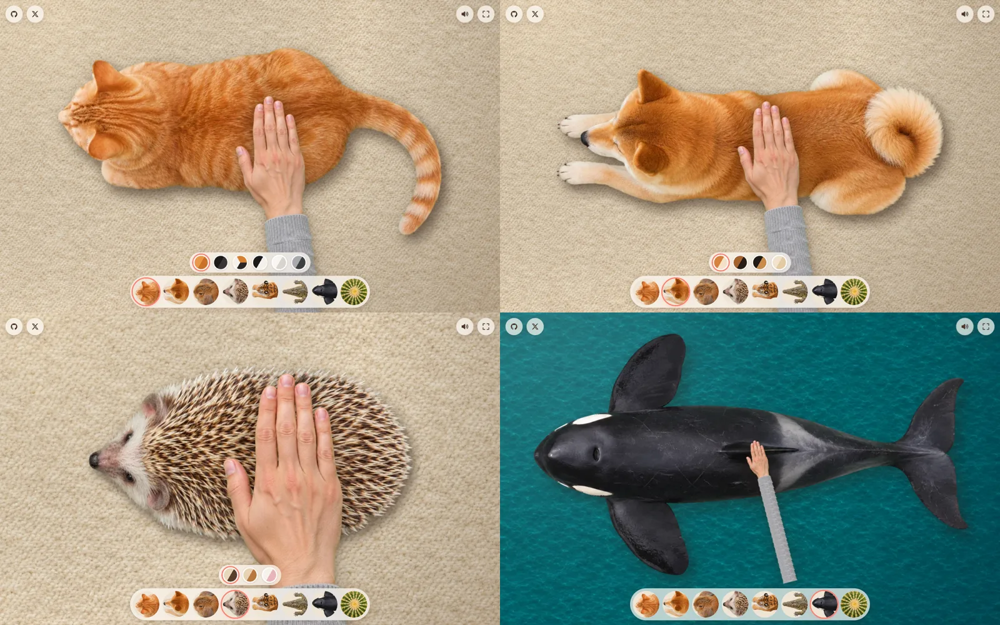

# 万物皆可撸 · Pet Everything

俯视视角、写实画风的“撸”动物网页小玩具。把手放上去摸一摸：皮毛会被手掌拖动、压下、在指间鼓起，逆毛会炸起来；动物会呼噜、喘气、哼唧，摸刺猬和仙人球会被扎出血。

**在线试玩：<https://pet-everything.stv1024.asia>**



*A web toy for petting photorealistic animals from a top-down view. Inspired by [Pet the Cat](https://pet-the-cat.pages.dev/) by [@zubububu](https://x.com/zubububu), extended with more animals and objects.*

## 玩法

| 操作 | 作用 |
| --- | --- |
| 鼠标移到动物身上 | 抚摸 |
| 按住左键 | 用力按 |
| 快速单击 | 轻拍 |
| 底部栏 | 换动物、换毛色 |
| ← → | 换动物 |
| 空格 | 自动抚摸 |
| M / F | 静音 / 全屏 |

手机上用手指摸。

## 动物和物品

猫（6 种毛色）、柴犬（4 种）、垂耳兔（5 种）、刺猬（3 种）、老虎（3 种）、鳄鱼、虎鲸、仙人球（金琥，普通 / 开花）。

每种都有自己的喜好、叫声和手感：老虎和虎鲸比手大得多；鳄鱼和仙人球很硬，几乎压不动；刺猬顺着刺摸没事，逆着摸会扎手。

## 怎么做的

- **画面**：每只动物是一张 AI 生成的俯视照片（绿幕或品红幕上生成，再抠图），贴在 WebGL 网格上实时形变。
- **手感**：手掌下有一块椭圆接触斑，皮肤被手拖着走、停手后像弹簧一样弹回；接触斑内下陷、外圈鼓起、手前方堆起皮褶，并按左上方的光源算出明暗（`src/engine/skinPress.ts`）。
- **毛**：从照片的明暗算出毛流方向，逆毛抚过的地方毛尖掀起、变亮、变乱，约 1 秒后落回（`src/engine/gl/skin.ts`）。
- **声音**：全部用 Web Audio 实时合成，没有音频文件：呼噜是离线渲染的循环，叫声用共振峰合成，摩擦声随材质和手速变化。
- **技术栈**：Vite + TypeScript，无 UI 框架；画面分三层 canvas（背景 2D、动物 WebGL2、手和粒子 2D）。

## 本地运行

需要 Node.js 20.19 或更新版本。

```bash
npm install
npm run dev        # http://127.0.0.1:5188/
```

Windows 上也可以直接双击根目录的 `打开游戏.bat`。

想加新的动物或物品，看 [写实素材管线](docs/写实素材管线.md)（生图、抠图、标注）和 [物种开发指南](docs/物种开发指南.md)（`PhotoDef` 各字段、调试工具）。生图脚本需要自己的生图接口和 Key（见素材管线文档）。

## 致谢与引用

- 本项目受 **[Pet the Cat](https://pet-the-cat.pages.dev/)**（作者 [@zubububu](https://x.com/zubububu)）启发：俯视视角、写实照片、手掌接触形变的玩法都来自原作。这里是一个非官方的同人重做和扩展，增加了更多动物、物品和互动。
- 手掌接触形变的物理模型（皮肤剪切弹簧、接触斑压缩、外圈鼓起、前方皮褶、短暂的毛面光泽）参考了原作的做法：我们研究了原作公开的网页前端，然后用自己的代码重新实现。本仓库不包含原作的代码、图片或其他素材。
- “Pet the Cat”的名称、画面和代码归原作者所有。如果原作者对本项目有任何意见，请[提 issue](https://github.com/stv1024/pet-everything/issues) 联系。
- 动物、手和地面的图片用 GPT Image（`gpt-image-2.6`）生成；提示词在 [assets/prompts/](assets/prompts/)。
- 开发过程中大量使用了 [Claude Code](https://claude.com/claude-code)。

## 许可

代码和本仓库的图片素材以 [MIT](LICENSE) 许可发布。
